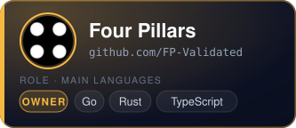
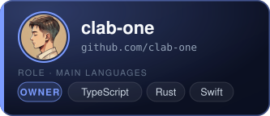
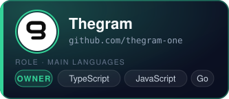

<h2 align="center">Organizations</h2>

  
  
  

<h2 align="center">Stack</h2>

  
  
  
  
  
  
  
   
  
  

<h2 align="center">Activity</h2>

  

  Counts include private repositories in the organizations above. Only aggregate numbers are shown; repository names and code stay private.

