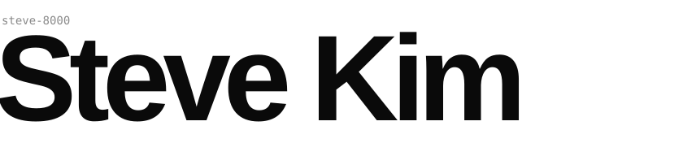
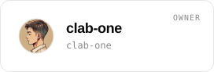
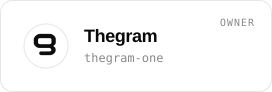
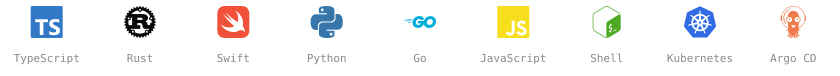
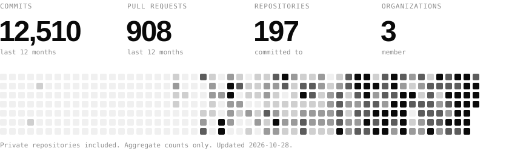

<picture>
  <source media="(prefers-color-scheme: dark)" srcset="./assets/header-dark.svg">
  
</picture>

TypeScript, Rust, Swift, Python and Go.
Kubernetes and GitOps infrastructure.

## 01 / Organizations

<a href="https://github.com/FP-Validated">
<picture>
  <source media="(prefers-color-scheme: dark)" srcset="./assets/org-fp-validated-dark.svg">
  
</picture>
</a>
<a href="https://github.com/clab-one">
<picture>
  <source media="(prefers-color-scheme: dark)" srcset="./assets/org-clab-one-dark.svg">
  
</picture>
</a>
<a href="https://github.com/thegram-one">
<picture>
  <source media="(prefers-color-scheme: dark)" srcset="./assets/org-thegram-one-dark.svg">
  
</picture>
</a>

## 02 / Stack

<picture>
  <source media="(prefers-color-scheme: dark)" srcset="./assets/stack-dark.svg">
  
</picture>

## 03 / Activity

<picture>
  <source media="(prefers-color-scheme: dark)" srcset="./assets/activity-dark.svg">
  
</picture>
